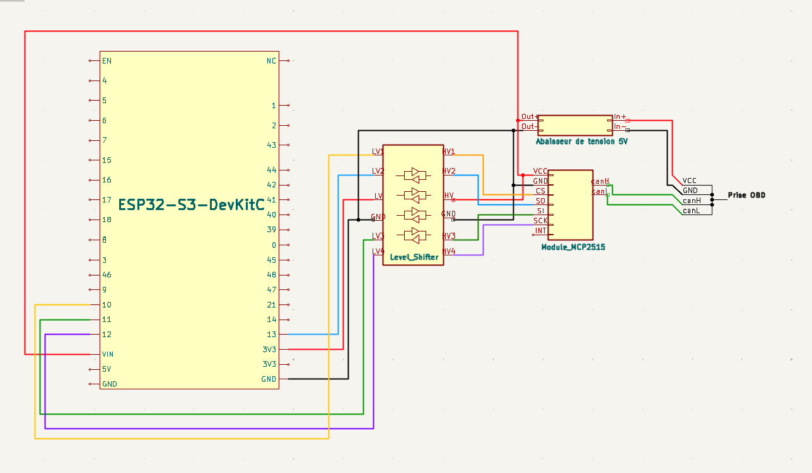

# VROOM-API


**VROOM-API** transforme une **Opel Corsa D** en objet connecté sans modifier un seul câble du véhicule. Le boîtier, branché sur la prise **OBD-II**, lit passivement le bus **CAN** via un contrôleur **MCP2515** et expose en temps réel les données du véhicule sur un réseau **WiFi en UDP**, avec une bibliothèque cliente en **C** prête à l'emploi.

---

## Contexte du projet

Projet réalisé durant l'année **2025–2026** dans le cadre du **Projet Scientifique et Technique (PST)** de 2ᵉ année à l'**ESIEA (campus de Laval)** par **Augustin Levrard**, **Matteo Lebarbier**, **Thomas Mathieu** et **Daniil Gutcaki**.

Une version antérieure du projet envoyait des requêtes OBD-II en boucle, saturant le bus CAN et empêchant parfois le véhicule de démarrer. Nous avons repris l'architecture de zéro pour concevoir un socle réutilisable : lecture propre du bus, reverse engineering des trames constructeurs et exposition via une API réseau simple utilisable en une ligne de code par plusieurs clients simultanément.

---

## Le Boîtier (Hardware)

Le boîtier est conçu pour se loger discrètement derrière le tableau de bord, alimenté directement par le port **OBD-II**.



### Composants

| Composant | Rôle |
| :--- | :--- |
| **ESP32-S3-DevKitC** | Microcontrôleur principal : décodage CAN, point d'accès WiFi et serveur UDP |
| **Module MCP2515** | Contrôleur et transceiver CAN externe (SPI) pour lire le bus sans le saturer |
| **Level Shifter (4 canaux)** | Adaptation logique bidirectionnelle entre le MCP2515 (5 V) et l'ESP32-S3 (3,3 V) |
| **Abaisseur de tension 5 V** | Régulation du 12 V–14 V de la prise OBD-II vers un rail 5 V stable |
| **Interrupteur physique** | Coupure manuelle à l'arrêt pour préserver la batterie du véhicule |

### Brochage SPI (ESP32-S3 ↔ Level Shifter ↔ MCP2515)

| Signal SPI | ESP32-S3 (3,3 V) | Level Shifter (LV ↔ HV) | MCP2515 (5 V) |
| :--- | :---: | :---: | :---: |
| **CS** | `GPIO 10` | `LV1` ↔ `HV1` | `CS` |
| **MOSI** | `GPIO 11` | `LV3` ↔ `HV3` | `SI` |
| **SCK** | `GPIO 12` | `LV4` ↔ `HV4` | `SCK` |
| **MISO** | `GPIO 13` | `LV2` ↔ `HV2` | `SO` |

- **OBD-II :** `VCC` / `GND` sur `In+` / `In-` de l'abaisseur 5 V ; `CAN_H` / `CAN_L` sur `canH` / `canL` du MCP2515.
- **Alimentation :** `Out+` (5 V) alimente `VIN` (ESP32-S3), `VCC` (MCP2515) et `HV` (Level Shifter) ; `3V3` de l'ESP32 alimente `LV` ; masses (`GND`) communes.

---

## Reverse Engineering du bus CAN

Aucune base de données publique des trames CAN n'existant pour l'Opel Corsa D, nous avons adapté **CAN Commander** sur ESP32 pour isoler les identifiants en deux phases :

1. **Calibration :** enregistrement de la ligne de base des identifiants actifs au repos.
2. **Monitoring différentiel :** observation en temps réel des trames qui varient lors d'une action ciblée (frein, volant, porte, clignotant), puis décodage de l'endianness et des facteurs d'échelle. Pour le régime moteur (**RPM**), qui fluctue en continu même au ralenti, une approche inversée a permis de filtrer puis d'isoler manuellement l'identifiant exact.

---

## API UDP WiFi

Le protocole **UDP** a été retenu face à TCP pour sa faible latence (**1 à 5 ms** contre 20+ ms), adaptée à une télémétrie rafraîchie plusieurs dizaines de fois par seconde et consommée par plusieurs clients en parallèle.

### Commandes disponibles (13 paramètres)

| Commande | Donnée renvoyée | Format |
| :--- | :--- | :--- |
| `GET_RPM` | Régime moteur (tr/min) | Numérique |
| `GET_DOOR` | État des portes | Booléen |
| `GET_TURN_SIGNAL` | Clignotants (G / D / Off) | Énuméré |
| `GET_LIGHTS_CALL` | Appels de phares | Booléen |
| `GET_LIGHTS_TYPE` | Type de feux actifs | Énuméré |
| `GET_AUTOLIGHTS_STATE` | Feux automatiques | Booléen |
| `GET_FRONT_WINDSHIELD` | Essuie-glace avant | Booléen |
| `GET_FRONT_GLASS_WASH` | Lave-vitre avant | Booléen |
| `GET_STEERING_WHEEL` | Angle du volant (degrés) | Numérique |
| `GET_CLUTCH` | Pédale d'embrayage | Booléen |
| `GET_BRAKES` | Pédale de frein | Booléen |
| `GET_ACCELERATOR` | Position accélérateur (%) | Numérique |
| `GET_GEAR` | Rapport enclenché | Numérique |

### Exemple avec la bibliothèque cliente C (`VROOM_API_CALL/`)

```c
#include <stdio.h>
#include "udp_client.h"

int main(void) {
    setup_network();
    char response[256];
    send_udp_request("GET_RPM", response, sizeof(response));
    printf("RPM : %s\n", response);
    return 0;
}